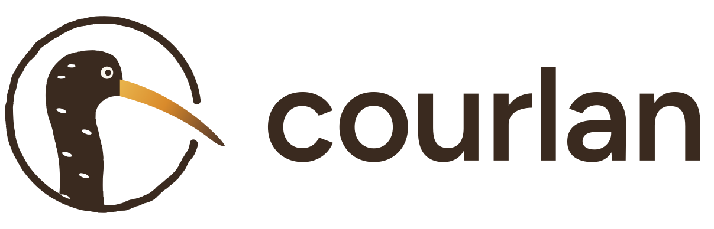

<picture>
  <source media="(prefers-color-scheme: dark)" srcset="https://raw.githubusercontent.com/adbar/courlan/master/docs/source/_static/courlan-lockup-dark.svg">
  
</picture>

# coURLan: Filter, clean, and sample URLs for web crawling


[](https://pypi.python.org/pypi/courlan)
[](https://pypi.python.org/pypi/courlan)
[](https://codecov.io/gh/adbar/courlan)
[](https://courlan.readthedocs.io/en/latest/)


## Why coURLan?

> "It is important for the crawler to visit 'important' pages first,
> so that the fraction of the Web that is visited (and kept up to date)
> is more meaningful." (Cho et al. 1998)
>
> "Given that the bandwidth for conducting crawls is neither infinite
> nor free, it is becoming essential to crawl the Web in not only a
> scalable, but efficient way, if some reasonable measure of quality or
> freshness is to be maintained." (Edwards et al. 2001)

This library provides an additional "brain" for web crawling, scraping
and document management. It facilitates web navigation through a set of
filters, enhancing the quality of resulting document collections:

- Validate, clean, and normalize URLs, including tracker removal
- Save bandwidth by steering clear of spam, unwanted content types, and
  low-value pages
- Identify pages by language with locale-aware heuristics
- Sample URLs by domain and pinpoint pages relevant for link gathering
- Store, deduplicate, and schedule URLs with a crawl-ready data store
- Use it from Python or on the command line

<p align="center">
  <a href="https://youtu.be/vN0UyARvPs8"></a>
</p>


**Wade through the Web and keep the good links.** The logo shows a
[courlan](https://en.wiktionary.org/wiki/courlan), also called limpkin.


## Installation

This package requires Python 3.10 or higher and is tested on Linux, macOS
and Windows systems.

courlan is available on [PyPI](https://pypi.org/) and installs with `pip`:

```bash
pip install courlan
pip install git+https://github.com/adbar/courlan.git  # latest available code
```

For older Python versions, see the
[installation guide](https://courlan.readthedocs.io/en/latest/getting-started.html#prerequisites).


## Quickstart

In Python — validate, clean, and filter URLs with `check_url`:

```python
>>> from courlan import check_url

# cleaned URL and domain name
>>> check_url('https://example.org/page?utm_source=twitter')
('https://example.org/page', 'example.org')

# rejected URLs return None
>>> check_url('http://666.0.0.1/')  # bogus domain

# language-aware filtering
>>> check_url('https://www.un.org/en/about-us', language='en')
('https://www.un.org/en/about-us', 'un.org')
>>> check_url('https://www.un.org/en/about-us', language='de')  # returns None
```

Most filters revolve around the `strict` and `language` arguments. See the
[check_url guide](https://courlan.readthedocs.io/en/latest/usage/python.html#check-url)
for all options.

On the command line — filter a file of URLs:

```bash
# one URL per line in urls.txt
courlan -i urls.txt -o cleaned.txt -d discarded.txt
# cleaned.txt contains accepted URLs, discarded.txt contains rejected ones
```

Run `courlan --help` or see the
[CLI documentation](https://courlan.readthedocs.io/en/latest/usage/cli.html)
for all command-line options.


## Python

### Sampling by domain name

```python
>>> from courlan import sample_urls
>>> my_urls = ['https://example.org/' + str(x) for x in range(100)]
>>> my_sample = sample_urls(my_urls, 10)
```

See the [sampling guide](https://courlan.readthedocs.io/en/latest/usage/python.html#sampling) for all options.

### Web crawling and URL handling

Use `extract_links()` for general-purpose link extraction. For
crawl-aware extraction with robots.txt rules and link prioritization,
use `filter_links()` instead — it returns two lists: regular links and
priority (navigation) links.

```python
>>> from courlan import extract_links
>>> doc = '<html><body><a href="test/link.html">Link</a></body></html>'
>>> extract_links(doc, "https://example.org")
['https://example.org/test/link.html']
```

For frontier management utilities (`is_external`, `is_navigation_page`,
`is_not_crawlable`, …) see the
[crawling guide](https://courlan.readthedocs.io/en/latest/usage/crawling.html).

### Python helpers

```python
>>> from courlan import clean_url
>>> clean_url('HTTPS://WWW.DWDS.DE:443/')
'https://www.dwds.de'
```

For `normalize_url`, `validate_url`, `get_base_url`, `get_hostinfo`,
and other utilities see the
[cleaning guide](https://courlan.readthedocs.io/en/latest/usage/python.html#cleaning).


## UrlStore class

The `UrlStore` class allows for storing and retrieving domain-classified
URLs, where a URL like `https://example.org/path/testpage` is stored as
the path `/path/testpage` within the domain `https://example.org`:

```python
>>> from courlan import UrlStore
>>> store = UrlStore()
>>> store.add_urls(['https://example.org/page1', 'https://example.org/page2'])
>>> store.get_url('https://example.org')
'https://example.org/page1'
>>> store.find_unvisited_urls('https://example.org')
['https://example.org/page2']
```

See the [UrlStore guide](https://courlan.readthedocs.io/en/latest/usage/urlstore.html) for all methods,
options, persistence, and crawl scheduling.


## Settings

Language filtering reads language codes in URL paths for any language,
and in subdomains with `strict=True`. Language names in `lang=` query
values are mapped for English and German by default. See the
[settings reference](https://courlan.readthedocs.io/en/latest/api/settings.html)
for how to review and override filtering rules.


## Author

Initially launched to create text databases for research purposes
at the Berlin-Brandenburg Academy of Sciences (DWDS and ZDL units),
this package continues to be maintained but its future development
depends on community support.

**If you value this software or depend on it for your product, consider
sponsoring it and contributing to its codebase**. Your support
[on GitHub](https://github.com/sponsors/adbar) or [ko-fi.com](https://ko-fi.com/adbarbaresi)
will help maintain and enhance this package.
Visit the [Contributing page](https://github.com/adbar/courlan/blob/master/CONTRIBUTING.md)
for more information.

Reach out via the software repository or the [contact
page](https://adrien.barbaresi.eu/) for inquiries, collaborations, or
feedback.

For more on Courlan's software ecosystem see [this
graphic](https://github.com/adbar/trafilatura/blob/master/docs/software-ecosystem.png).


## License

*coURLan* is distributed under the [Apache 2.0
license](https://www.apache.org/licenses/LICENSE-2.0.html).

Versions prior to v1 were under GPLv3+ license.


## Similar work

These Python libraries perform URL handling and normalization but do not
provide language-aware filtering, content heuristics, crawl scheduling,
or a domain-classified URL store:

-   [furl](https://github.com/gruns/furl)
-   [ural](https://github.com/medialab/ural)
-   [yarl](https://github.com/aio-libs/yarl)


## References

-   Cho, J., Garcia-Molina, H., & Page, L. (1998). Efficient crawling
    through URL ordering. *Computer networks and ISDN systems*, 30(1-7),
    161–172.
-   Edwards, J., McCurley, K. S., and Tomlin, J. A. (2001). "An
    adaptive model for optimizing performance of an incremental web
    crawler". In *Proceedings of the 10th international conference on
    World Wide Web - WWW'01*, pp. 106–113.
